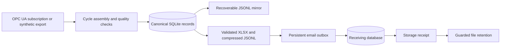

# Industrial Edge Process Logger

**Reliable process telemetry from an industrial edge device to a traceable database and report.**

A Python engineering portfolio project for read-only OPC UA acquisition on a Raspberry Pi or
Linux edge computer. It demonstrates fault recovery, timestamp-aware cycle assembly, data
quality handling, durable storage, Excel reporting and conservative email delivery.

**The demonstration is entirely synthetic.** The example machine, job, product, material and
readings are fictional. No plant connection, account, hardware or SMTP server is needed to run it.

## Engineering highlights

- **Industrial integration:** asynchronous OPC UA subscriptions, bounded queues, reconnects and
  timestamp-matched cycle snapshots.
- **Data integrity:** source/receive timestamps, status-code handling, duplicate protection and
  transactionally committed cycle payloads.
- **Fault tolerance:** raw-archive recovery, resumable imports, validated reports and an auditable
  email outbox that preserves uncertain delivery outcomes.
- **Traceability:** configurable job, product, mould and material context; part quantities remain
  unknown when cavity or reject semantics are unavailable.
- **Edge operations:** health observations, Linux service templates and a hardware-independent
  UPS command interface.

## Architecture



SQLite commits an accepted cycle and its counters before the raw mirror is written. An abrupt
restart can rebuild an incomplete mirror from committed records. Workbook creation and SMTP
run outside the acquisition loop. Mail acceptance alone never permits file deletion.

## Run the offline demonstration

Requires Python 3.11 or newer. From this repository's root:

```shell
python -m venv .venv
# Activate .venv using your operating system's normal activation command.
python -m pip install -e ".[dev]"
python tools/run_demo.py
```

The demo generates fictional cycle data, builds and validates a workbook, ingests its cycle
export into a separate local receiving database, and prints reconciled counts. It sends no email
and makes no machine connection. Outputs stay in ignored `build/` directories.

See [the walkthrough](docs/DEMO.md) and the readable
[synthetic data preview](examples/synthetic_preview.csv).

## Checks

```shell
python -m pytest -q
python -m ruff check src tests tools
python -m ruff format --check src tests tools
python -m mypy src
python tools/check_publication.py
```

Tests construct their own data. They cover a loopback OPC UA simulator, quality codes,
out-of-order notifications, process interruption, import recovery, duplicate protection, report
integrity, delivery backoff, storage receipts and database migration. CI is configured for Linux
and Windows; a successful hosted run can only be claimed after GitHub has executed it.

## Repository map

| Location | Purpose |
| --- | --- |
| `src/edge_logger/` | Acquisition, storage, analysis, reporting, delivery and operations |
| `config/` | Fictional configuration with external integrations disabled |
| `tools/` | Synthetic demo, local simulator and publication checks |
| `tests/` | Synthetic regression and fault-injection tests |
| `deploy/` | Optional Linux service and network-isolation templates |
| `docs/` | Design decisions, operations, demonstration and portfolio notes |

## Scope and limits

This repository demonstrates software behaviour with synthetic data and a local simulator.
It does not claim a particular production deployment, certified hardware integration, quantified
savings, or capture during unbuffered network outages. Real deployment requires approved read-only
access, verified cycle/timestamp semantics, units, security settings, production-state signals
and an agreed history-reconciliation process.

Deployment templates are examples. Automatic retention and UPS shutdown are disabled in the
demo configuration. SMTP credentials belong in environment variables; live configuration and
generated operational data must stay out of Git.

Read [architecture](docs/ARCHITECTURE.md), [operations](docs/OPERATIONS.md),
[publication guidance](docs/PUBLICATION.md) and [CV/interview notes](docs/CV_AND_INTERVIEW.md).
No open-source licence has been selected; choose one only for material you are authorised to distribute.
